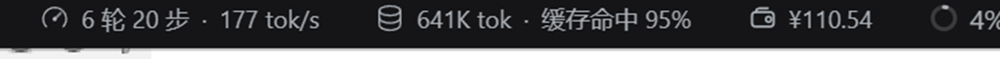
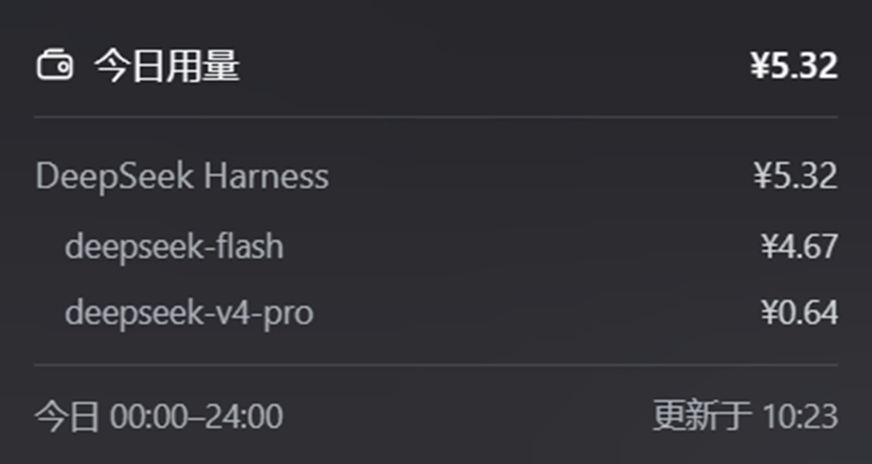

# dsh-remaining-balance

Shows your signed-in DeepSeek account balance as a wallet icon and amount in the DeepSeek Harness composer statistics row, and opens today's cost per API key and model on click.

**English** | [简体中文](README.zh-CN.md)





> The `👛 ¥108.28` chip at the right end of the row is this plugin. Clicking it opens the **Today's usage** panel, which reads the same data as the DeepSeek Platform usage page. Screenshots show the Harness UI in Chinese; the plugin follows the interface language for its own copy.

## Features

- **See what is left at a glance.** One extra entry in the row next to the turn/speed and token pills, with the same font size, color, and spacing as the built-in readings.
- **Click for today's usage.** The panel lists today's cost for each API key and, indented, for each model under it. The range is fixed to today `00:00–24:00` in the local time zone.
- **One source per value.** The balance comes from Harness's account service (the same value as **Settings → Account**); today's usage comes from `/api/v0/usage/by_api_key/cost`, the endpoint the Platform usage page uses, authorized with the same account login.
- **Refreshes itself.** The balance re-reads every 60 seconds and whenever the window regains focus. The usage panel reads when opened and reuses a 60-second cache.
- **No model requests.** Only the account balance and usage are read; no prompt is sent.
- **Never invents numbers.** Nothing renders while signed out, loading, or after a failed read; a negative balance is shown in the warning color.
- **Hover for the split.** The tooltip keeps the topped-up and granted wallet rows separate.
- **Follows the theme.** Every color is a Harness theme variable, and the panel uses the same menu material as the built-in statistics dialogs.

## Install

Prerequisites:

- DeepSeek Harness (Desktop or Web), signed in to a DeepSeek account.
- `git` on `PATH` when installing from the repository (Harness's plugin installer drives pnpm and git).

### Option 1 — from GitHub (recommended, one line)

Open **Plugins → Add plugin** and enter:

```
github:hyc3z/dsh-remaining-balance
```

or the equivalent full address:

```
https://github.com/hyc3z/dsh-remaining-balance
```

Install, then refresh the page with `Ctrl+R`.

> **Add plugin** accepts a package name, a Git address, a tarball, or an absolute local path — the same spec `dsh plugin add` takes.

### Option 2 — packaged tarball

Download `dsh-remaining-balance-<version>.tgz` from [Releases](https://github.com/hyc3z/dsh-remaining-balance/releases) and enter its absolute path in **Add plugin**.

### Option 3 — local directory

```sh
git clone https://github.com/hyc3z/dsh-remaining-balance.git
```

Choose that directory in **Add plugin**.

### About the DeepSeek plugin store

The **Plugins** page ships an official catalog (Discover) that only lists plugins distributed with the installation; there is **no public submission entry for third-party plugins**. Third-party bundles are distributed through the three routes above: a Git address, a tarball, or a local directory. The package name `dsh-remaining-balance` is available on npm, so a future publish would make `Add plugin → dsh-remaining-balance` work too.

To remove it, switch the bundle off on the **Plugins** page or remove it; nothing is left behind.

## Today's usage panel

- Host reads `GET https://platform.deepseek.com/api/v0/usage/by_api_key/cost?start=<day-start>&end=<next-day-start>&tz=<offset>`, which returns hourly cost per `api_key` × `model`, and folds it into one row per key with model sub-rows.
- The endpoint accepts **whole local days only**, so the panel always shows today and offers no date picker.
- The Host caches the result for 60 seconds so reopening the panel does not re-query Platform.
- Only amounts, key names, and model names cross the route; no token, cookie, or API key is returned.

## How it works

- **Host half** (`index.js`) registers two read-only routes:
  - `GET /dsh-remaining-balance/balance` — reads the balance through Harness's `deepseekAccount` service.
  - `GET /dsh-remaining-balance/usage` — reads today's cost with `getPlatformSession()`.
- **Client half** (`client.js`) registers one `conversation.composer.dock` entry and portals the panel to `body` so the composer cannot clip it. The balance prefers the Host route and falls back to the account Remote in the browser.
- Diagnostics: the Host writes the last result code to `$DSH_HOME/balance-pill/diagnostics.json` (no amounts beyond the pill, no tokens).

## Limitations

- Only one currency is headlined (CNY first); with a USD balance as well, the tooltip still shows the split.
- Both values need the Platform account. An installation that only uses an API key and never signed in shows no pill.
- The Platform usage endpoint is not a public API and may change; if it does, the panel reports that today's usage is unavailable while the balance keeps working.
- The balance refresh rate is fixed at 60 seconds plus focus refreshes.

## Layout

```
.
├── package.json              # bundle manifest (dsh.bundle + dsh.client)
├── cordis.patch.yml          # inserts the remaining-balance row
├── index.js                  # Host: read-only balance and usage routes
├── client.js                 # Client: dock entry + usage panel
├── icon.svg                  # plugin icon
├── locale/en.json            # English title and description in the plugin list
├── locale/zh.json            # Chinese title and description
├── docs/preview.png          # screenshot: the balance pill
├── docs/preview-panel.png    # screenshot: today's usage panel
└── .github/workflows/release.yml  # pack and release on a tag
```

## Development

- No build step: `index.js` and `client.js` load as plain JavaScript.
- After an edit, re-enable the bundle on the **Plugins** page and refresh the page.
- Release: pushing a `v*` tag makes GitHub Actions run the syntax checks, `npm pack`, and attach the tarball to a Release. With an `NPM_TOKEN` secret, an `npm publish` step can follow.

## License

MIT
